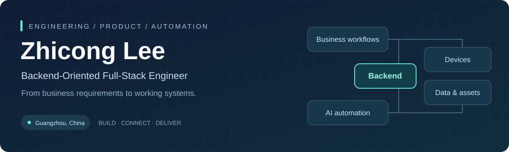
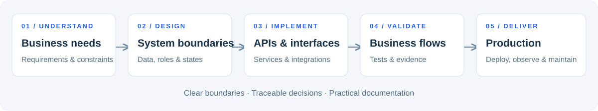

# Hi, I'm Zhicong Lee 👋

I build software around real business workflows—from connected-device platforms and internal management systems to AI-assisted product research.

Based in Guangzhou, China. My work spans requirements, backend architecture, frontend integration, data modeling, deployment, and ongoing maintenance.

  
  
  

## 👨‍💻 About Me

I work across product and engineering, turning ambiguous requirements into systems people can use and maintain. I care about the details that make those systems dependable: permissions, state transitions, data provenance, failure handling, and production operations.

I use AI coding agents and automation as part of my development workflow, with an emphasis on clear task boundaries, reusable instructions, regression checks, and verifiable results.

## 🗂️ Projects at a Glance

| Project | Domain | Engineering focus |
| :--- | :--- | :--- |
| 🏢 **OA System** | Enterprise collaboration | Approval logic, file previews, production delivery |
| 🔎 **ProductSelect** | AI-assisted commerce research | Structured reports, evidence tracking, agent workflows · **In progress** |
| 📅 **Kylendar** | Connected devices | E-ink integration, calendar APIs, asset storage |
| 🛠️ **R&D Management** | Engineering operations | Permissions, lifecycle tracking, audit history |
| 🎨 **Grafiqor** | Media & content | Backend services, asset pipelines, deployment |

## 🚀 Selected Projects

### 🏢 OA Workflow & Collaboration System

   

An enterprise office automation system built on RuoYi-Vue-OA, with Java/Spring Boot, Vue, and Flowable.

- Extended and maintained approval workflows, including approval decisions, rejection behavior, and node transitions.
- Integrated document and attachment previews across Office files, PDFs, images, text, audio, video, and archives, with download fallback for unsupported formats.
- Delivered changes through frontend and backend validation, production deployment, service checks, and rollback preparation.

### 🔎 ProductSelect — AI-Assisted Product Research

   

An ongoing Amazon product research and selection workflow combining structured reports, evidence tracking, scripts, and agent coordination.

- Built a standardized reporting workflow with 23 fields, evidence records, pricing calculations, and validation tools.
- Organized research around market demand, competition, product specifications, costs, and decision readiness.
- Structured agent work into reporting, evidence and decision support, and controlled execution layers.
- Currently extending data collection and closing product, logistics, cost, and compliance evidence gaps before final Go/No-Go decisions.

### 📅 Kylendar — Connected Smart Calendar

  

A smart calendar platform connecting e-ink devices with backend services, web applications, and asset storage.

- Led backend-oriented full-stack development across APIs, web features, device integration, and deployment.
- Built workflows for calendars, weather, multiple time zones, user assets, and object storage.
- Supported product pages, documentation, multilingual materials, and launch requirements.

### 🛠️ R&D Management System

   

An internal platform for projects, requirements, tasks, defects, testing, releases, and team collaboration.

- Built with React, Spring Boot, MySQL, and Flyway.
- Designed APIs, authentication, role-based permissions, status histories, audit logs, and notification workflows.
- Focused on traceable business flows, permission boundaries, and regression testing.

### 🎨 Grafiqor — Media & Content Workflows

A media-oriented web platform covering content, assets, backend services, and production workflows.

- Developed backend services, storage integrations, task workflows, and deployment foundations.
- Worked across product planning, frontend collaboration, backend implementation, and infrastructure.

## 🧰 Toolset

  

- **Backend:** Java, Spring Boot, Node.js, NestJS, Python, REST APIs
- **Frontend:** React, Vue, TypeScript, JavaScript, Next.js, Tailwind CSS, Vite
- **Data & Storage:** MySQL, PostgreSQL, Redis, MinIO, Flyway
- **Infrastructure:** Linux, Docker, Nginx, Cloudflare, GitHub Actions
- **Business Workflows:** Flowable, approval systems, role-based access control, audit trails
- **AI & Automation:** Codex, agent workflows, reusable skills, browser automation, ComfyUI, multimodal content pipelines

## 🧭 How I Build

## 🌱 Current Focus

- Building dependable business systems with clear permissions and workflow semantics.
- Connecting AI agents, data collection, and validation into practical research workflows.
- Improving production reliability and maintaining systems through successive releases.
- Turning project experience into reusable tools, documentation, and engineering practices.

## 💡 Engineering Principles

Start with the business problem. Make system behavior explicit. Validate important workflows. Keep evidence and assumptions distinguishable. Deliver changes that remain understandable and operable after launch.

---

Happy to connect on backend engineering, business systems, connected devices, and practical AI automation.
